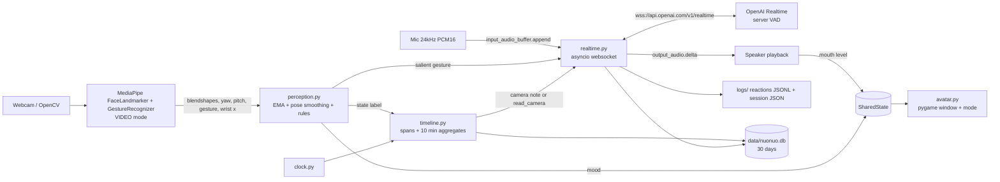

# Nuonuo 糯糯

Nuonuo is an energetic little anime companion that lives in a small always-on-top window. You talk to her by voice through the OpenAI Realtime API. A webcam perception layer (MediaPipe) tells her when you smile, frown, look surprised or tired, look away, leave, come back, or make a hand gesture, so she can react the way a friend would.

## Setup (Windows 11, uv)

1. Install [uv](https://docs.astral.sh/uv/): `powershell -ExecutionPolicy ByPass -c "irm https://astral.sh/uv/install.ps1 | iex"`
2. In the project folder:
   ```powershell
   uv sync
   copy .env.example .env
   notepad .env          # set OPENAI_API_KEY
   uv run nuonuo
   ```
   `uv run python -m nuonuo` works too. The first run downloads `face_landmarker.task` and `gesture_recognizer.task` (about 12 MB) into `models/`.
3. Allow camera and microphone access for desktop apps in Windows Settings → Privacy & security. Use headphones, because speaker echo can trigger barge-in.

### Flags

| Flag | Effect |
|---|---|
| `--no-vision` | Turn off the webcam (same as `VISION_ENABLED=false`) |
| `--preview` | Show a debug webcam window with landmarks, blendshape values, and states |
| `--no-voice` | Avatar and vision only, with no API calls (vision events go to the console) |
| `--camera N` | Use webcam index N |
| `--model NAME` | Override `NUONUO_MODEL` (e.g. `gpt-realtime-2.1`) |
| `--mode chatty` or `--mode quiet` | `chatty` (default) may comment on what she sees, at most about once a minute, and never while you are speaking. `quiet` only reacts to salient gestures and answers when asked. |
| `--forget` | Delete every saved session in `data/nuonuo.db` and exit |
| `-v` | Verbose logging |

### Keys (avatar window focused)

`V` toggles vision · `P` toggles preview · `M` toggles chatty/quiet · `Esc`/`Q` quits · `Ctrl+C` in the terminal also quits cleanly. The window shows the current mode.

### .env

`OPENAI_API_KEY`, `NUONUO_MODEL` (default `gpt-realtime-2.1-mini`), `NUONUO_SUMMARY_MODEL` (default `gpt-6-luna`, used only at session end), `VISION_ENABLED`, and optionally `USER_NAME` (default Andy) and `NUONUO_VOICE` (default `marin`).

## Architecture



Threads: pygame runs on the main thread, vision runs on its own thread, and the realtime client runs an asyncio loop on a third thread. Audio I/O uses sounddevice callbacks. A shared `stop` event shuts everything down. `clock.py` is the only source of session `t_ms`.

Perception turns each frame into a state label. `timeline.py` merges that into spans `(state, start_ms, end_ms)`. The last 60 seconds stay as spans. Older time, up to 10 minutes, is folded into aggregates such as "smiling 50% of last 10 min, away twice". Head pitch distinguishes looking away from looking down at a phone.

Camera notes are user text items prefixed `[camera note, do not read aloud]`. A note is sent when its text changes, and again every 8 seconds while it stays the same. In chatty mode a visual change can also request one spoken remark, at most about once a minute, and never while you are speaking or Nuonuo is already talking. Quiet mode never requests that remark.

Salient events (wave, coming back, thumbs up, peace sign, I-love-you) still send their own line and `response.create`, with the 6 s cooldown and the same don't-interrupt rules. The model can call `read_camera`, which returns the current state and the aggregate summary. The client answers with `conversation.item.create` (`function_call_output`) and then `response.create`.

When `input_audio_buffer.speech_started` arrives, playback stops at once and the unplayed part of her reply is removed with `conversation.item.truncate`.

At shutdown the transcript, camera-note log, recent spans, and timeline aggregates are written to `data/nuonuo.db`. A separate Responses API call (`NUONUO_SUMMARY_MODEL`, low reasoning effort, strict JSON) adds `summary`, `topics`, `mood_trend`, and `follow_ups`. If there is no API key, voice was disabled, or the call fails, the row is saved without a summary. The next session puts the last few summaries into the instructions. Frames and face landmarks are rejected and never stored. Rows older than 30 days are deleted at startup. `--forget` deletes all of them.

## Files

| File | Purpose |
|---|---|
| `src/nuonuo/app.py` | CLI, env loading, thread wiring, shutdown, session save |
| `src/nuonuo/clock.py` | Session clock. Every `t_ms` comes from here |
| `src/nuonuo/perception.py` | Meaning layer: blendshape smoothing, yaw/pitch smoothing, states, gestures. Thresholds are in `CONFIG` |
| `src/nuonuo/pose.py` | Yaw, pitch, and roll from the face matrix |
| `src/nuonuo/timeline.py` | Behaviour spans, 10-minute aggregates, `read_camera` payload |
| `src/nuonuo/notes.py` | Note heartbeat, chatty/quiet remark cap, Realtime tool events |
| `src/nuonuo/vision.py` | Model download, webcam, MediaPipe inference, debug preview |
| `src/nuonuo/realtime.py` | Realtime websocket session, mic/speaker, barge-in, camera notes, `read_camera` |
| `src/nuonuo/persona.py` | Nuonuo's system prompt, including recent-session memory |
| `src/nuonuo/memory.py` | SQLite session store, 30-day retention, landmark rejection |
| `src/nuonuo/summary.py` | End-of-session Responses API summary |
| `src/nuonuo/avatar.py` | Drawn face, mood, talking mouth, chatty/quiet label |
| `src/nuonuo/logs.py` | Reaction JSONL, session cost, token usage |
| `src/nuonuo/state.py` | Thread-safe shared state |
| `tests/fixtures/` | Scripted perception timelines. Tests do not open a webcam |

Run the tests with `uv run pytest`.

## Logs

- `logs/reactions-*.jsonl` has one line per camera note and per salient gesture sent, recording whether a response was requested and whether one followed within 8 s.
- `logs/session-*.json` has start and end times, duration, token usage from `response.done`, and an estimated cost (USD per 1M tokens). Mini: audio in $10, audio out $20, cached audio in $0.30, text in $0.60, text out $2.40. Full `gpt-realtime-2.1`: $32 / $64 / $0.40 / $4 / $24. Cached text input is billed at the normal text input rate because no separate rate was given.
- `logs/nuonuo.log` has the console log, including transcripts.

## Privacy

`data/nuonuo.db` stores the transcript, camera notes, behaviour aggregates, and the short summary for 30 days. It does not store webcam frames or the 478-point face mesh. A row that contains those fields, or a list of 400 or more points, is rejected. `--forget` wipes the file's sessions. The database is gitignored.

## Known limitations

- The face is a programmatic placeholder, not Live2D.
- Rule thresholds are heuristic. Tune them in `perception.CONFIG` using `--preview`.
- Head yaw and pitch use the mirrored-preview convention (positive yaw to your right, positive pitch chin up) and assume a front-facing webcam. Looking down means pitch at or below -15 degrees. The sign has not been checked on this laptop's camera.
- There is no echo cancellation, so use headphones.
- Always-on-top uses the Win32 `SetWindowPos` call and does nothing on other OSes.
- Realtime sessions are limited to 60 minutes, and there is no auto-reconnect yet.
- Camera notes, the `read_camera` tool, input transcription, and the end-of-session summary follow the current Realtime and Responses docs. They have not been tried on a live API session.
- The webcam is only open while vision is on. Turning vision off with `V` releases it. MediaPipe models still load at startup so that `V` can turn vision back on.
- `mediapipe` depends on `opencv-contrib-python`, and this project also lists `opencv-python`. Both provide `cv2`. If `cv2` misbehaves, remove `opencv-python` from `pyproject.toml` and run `uv sync` again.
