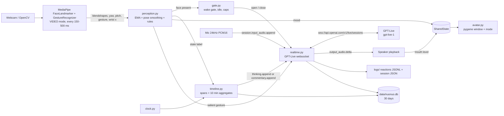

# Nuonuo 糯糯

Nuonuo is an energetic little anime companion that lives in a small always-on-top window. You talk to her by voice through the OpenAI Realtime API. A webcam perception layer (MediaPipe) tells her when you smile, frown, look surprised or tired, look away, leave, come back, or make a hand gesture, so she can react the way a friend would.

## Setup (Windows 11, uv)

1. Install [uv](https://docs.astral.sh/uv/): `powershell -ExecutionPolicy ByPass -c "irm https://astral.sh/uv/install.ps1 | iex"`
2. In the project folder:
   ```powershell
   uv sync
   copy .env.example .env
   notepad .env          # set OPENAI_API_KEY
   uv run nuonuo
   ```
   `uv run python -m nuonuo` works too. The first run downloads `face_landmarker.task` and `gesture_recognizer.task` (about 12 MB) into `models/`.
3. Allow camera and microphone access for desktop apps in Windows Settings → Privacy & security. Use headphones, because speaker echo can trigger barge-in.

### Flags

| Flag | Effect |
|---|---|
| `--no-vision` | Turn off the webcam (same as `VISION_ENABLED=false`) |
| `--preview` | Show a debug webcam window with landmarks, blendshape values, and states |
| `--no-voice` | Avatar and vision only, with no API calls (vision events go to the console) |
| `--camera N` | Use webcam index N |
| `--model NAME` | Override `NUONUO_MODEL` (default `gpt-live-1`) |
| `--mode chatty` or `--mode quiet` | `chatty` (default) may comment on what she sees, at most about once a minute, and never while you are speaking. `quiet` only reacts to salient gestures and answers when asked. |
| `--forget` | Delete every saved session in `data/nuonuo.db` and exit |
| `-v` | Verbose logging |

### Keys (avatar window focused)

`V` toggles vision · `P` toggles preview · `M` toggles chatty/quiet · `Esc`/`Q` quits · `Ctrl+C` in the terminal also quits cleanly. Pressing it again while she is shutting down doesn't cut the save short: it logs "Still saving the session" and exits once the save is done. The window shows the current mode. Click the window first so the keys land on it.

Tune the sprite avatar without the camera:

```powershell
uv run python -m nuonuo.avatar --preview
uv run python -m nuonuo.avatar --preview --wav clip.wav
uv run python -m nuonuo.avatar --calibrate
```

`--preview` starts on idle. `1` idle, `2` or `T` a test tone that drives talking, `3` happy, `4` sleepy, `5` surprised, `6` listening. The line under the picture shows the clip, the smoothed voice level, and the mouth bucket. `--calibrate` draws the mouth box on a talk frame. Arrow keys move it, `+`/`-` resize it, and `C` writes the box into `assets/anim/clips.yaml`.

### .env

`OPENAI_API_KEY`, `NUONUO_MODEL` (default `gpt-live-1`), `NUONUO_BACKEND_MODEL` (default `gpt-6-luna`, the delegated model that calls `read_camera`), `NUONUO_SUMMARY_MODEL` (default `gpt-6-luna`, used only at session end), `VISION_ENABLED`, and optionally `USER_NAME` (default Andy) and `NUONUO_VOICE` (default `marin`). A `NUONUO_MODEL` value that starts with `gpt-realtime` is treated as `gpt-live-1`.

Voice session gate and caps, all optional:

| Setting | Default | Effect |
|---|---|---|
| `WAKE_SECONDS` | `1.5` | A voice session opens only after your face has been in view this long. With the camera off or unavailable, about half a second of speech near the mic wakes her instead. |
| `IDLE_TIMEOUT_MIN` | `3` | Close the session after this many minutes with no face and no speech (yours or hers). |
| `SESSION_CAP_MIN` | `40` | Hard cap on one live session. At the cap she closes it, and once your face is back in view for `WAKE_SECONDS` she opens a fresh one, carrying on without a new greeting. |
| `DAILY_CAP_MIN` | `120` | Voice minutes per local day. Once reached, she rests until tomorrow; the avatar and camera keep running. |

Minutes accept decimals, and `0` turns a timeout or cap off. Daily usage is kept in `data/voice_usage.json`, so a restart doesn't reset it. The status line under the avatar shows `sleeping`, `reconnecting in Ns`, or `resting: daily cap`.

## Architecture



Threads: pygame runs on the main thread, vision runs on its own thread, and the voice client runs an asyncio loop on a third thread. Audio I/O uses sounddevice callbacks. A shared `stop` event shuts everything down. `clock.py` is the only source of session `t_ms`.

The mic stream, speaker, and session clock stay open for the whole run. Live sessions open and close underneath them:

- **Wake gate** (`gate.py`). No session is open until a face has been in view for `WAKE_SECONDS`. A session closes after `IDLE_TIMEOUT_MIN` with no face and no speech, at `SESSION_CAP_MIN`, or when `DAILY_CAP_MIN` runs out. The minutes of each session are logged and added to `data/voice_usage.json` (checkpointed every minute while a session is open). A camera reading older than 3 s counts as "no camera", so a webcam that dies can't keep her awake.
- **Auto-reconnect** (`realtime.py`). If the socket drops, the server closes or expires the session, the start times out, or OpenAI answers `forbidden`, the session is reopened after 1 s, 2 s, 4 s, ... up to 30 s. The backoff resets after a session stays up for 30 s.
- **Recap** (`persona.ConversationRecap`). The last six turns and the current topic (the latest user turn of four or more words) are kept in memory. A reopened session's instructions add them after the persona prompt, with an instruction not to greet again or mention the connection. After an idle close she may say a short hello when you come back, without introducing herself again.
- **Sleep**. Windows Modern Standby suspends the app, and `time.monotonic()` keeps counting. A gap of 60 s or more between gate readings is treated as sleep. It is not counted as voice or idle time, and an open session is reopened right away, because the server has almost certainly dropped it.

Vision does not run MediaPipe on every frame. `perception.DetectionScheduler` runs face detection every `detect_min_seconds` (0.15) to `detect_max_seconds` (0.5): back to the minimum whenever the face moves, appears, leaves, or changes state, and stretched by `detect_slowdown` after each calm detection. The gesture recognizer runs on every `gesture_every`-th (4th) detection, and on every detection while a hand is in view (`gesture_boost_with_hand`), so a wave still gets enough wrist samples. Between detections the last reading is held, and the face position is held through a missed detection for `face_hold_seconds`, so the avatar's gaze doesn't jump. Between detections the vision thread sleeps. Each detection reads a fresh frame, because DirectShow's `read()` waits for the next new frame. With the preview open, every frame is read and drawn with the last results. If the webcam stops sending frames for 2 s it is released and reopened.

Perception turns each frame into a state label. `timeline.py` merges that into spans `(state, start_ms, end_ms)`. The last 60 seconds stay as spans. Older time, up to 10 minutes, is folded into aggregates such as "smiling 50% of last 10 min, away twice". Head pitch distinguishes looking away from looking down at a phone.

Camera notes are prefixed `[camera note, do not read aloud]` and sent with `session.thinking.append` when the text changes, and again every 8 seconds while it stays the same. That event does not ask her to speak. In chatty mode a visual change can also send `session.commentary.append`, at most about once a minute, and never while you are speaking or she is already talking. Quiet mode never sends that remark.

Salient events (wave, coming back, thumbs up, peace sign, I-love-you) send `session.commentary.append` under the same 6 s cooldown and don't-interrupt rules. Otherwise they are stored with `session.thinking.append`. `read_camera` is a tool on the delegated Responses model. A completed call arrives inside `response.event` as `response.output_item.done`. The client answers with `response.item.create` (`function_call_output`) and then `response.create`.

GPT-Live is full duplex and decides when to speak. There is no client truncate event. When your transcript starts, local playback is cleared so her queued audio does not keep playing over you. Switching mode with `M` sends `session.instructions.append`, because the instructions set at `session.start` cannot be replaced.

At shutdown the transcript, camera-note log, recent spans, and timeline aggregates are written to `data/nuonuo.db`. A separate Responses API call (`NUONUO_SUMMARY_MODEL`, low reasoning effort, strict JSON) adds `summary`, `topics`, `mood_trend`, and `follow_ups`. If there is no API key, voice was disabled, or the call fails, the row is saved without a summary. The save and the session log run in `shutdown.run_to_completion`, a non-daemon worker that the main thread waits on while holding back Ctrl+C. The session log is written in a `finally`, so it lands even if the save fails. If the voice thread is still closing, the open session's minutes are booked before the save. The next session puts the last few summaries into the instructions. Frames and face landmarks are rejected and never stored. Rows older than 30 days are deleted at startup. `--forget` deletes all of them.

## Files

| File | Purpose |
|---|---|
| `src/nuonuo/app.py` | CLI, env loading, thread wiring, shutdown, session save |
| `src/nuonuo/shutdown.py` | Runs the final save to the end even if Ctrl+C lands in the middle of it |
| `src/nuonuo/gate.py` | Wake gate, idle timeout, per-session and daily caps, sleep detection, `data/voice_usage.json` |
| `src/nuonuo/clock.py` | Session clock. Every `t_ms` comes from here |
| `src/nuonuo/perception.py` | Meaning layer: blendshape smoothing, yaw/pitch smoothing, states, gestures, detection cadence. Thresholds and intervals are in `CONFIG` |
| `src/nuonuo/pose.py` | Yaw, pitch, and roll from the face matrix |
| `src/nuonuo/timeline.py` | Behaviour spans, 10-minute aggregates, `read_camera` payload |
| `src/nuonuo/notes.py` | Note heartbeat, chatty/quiet remark cap, Realtime tool events |
| `src/nuonuo/vision.py` | Model download, webcam, MediaPipe inference, debug preview |
| `src/nuonuo/realtime.py` | GPT-Live websocket sessions with reconnect and backoff, mic/speaker, camera notes, `read_camera` |
| `src/nuonuo/persona.py` | Nuonuo's system prompt, recent-session memory, and the in-memory recap that seeds a reopened session |
| `src/nuonuo/memory.py` | SQLite session store, 30-day retention, landmark rejection |
| `src/nuonuo/summary.py` | End-of-session Responses API summary |
| `src/nuonuo/avatar.py` | Drawn face, mood, talking mouth, chatty/quiet label |
| `src/nuonuo/logs.py` | Reaction JSONL, session cost, token usage |
| `src/nuonuo/state.py` | Thread-safe shared state |
| `tests/fixtures/` | Scripted perception timelines. Tests do not open a webcam |

Run the tests with `uv run pytest`.

## Logs

- `logs/reactions-*.jsonl` has one line per camera note and per salient gesture sent, recording whether a response was requested and whether one followed within 8 s.
- `logs/session-*.json` has start and end times, wall-clock duration, `voice_sessions` (one entry per live session: minutes open, why it ended, and the server's reported seconds), `voice_minutes` (their total), `voice_seconds` from `session.usage.updated` and `session.closed` (within one live session the latest cumulative total is used, then the sessions are summed), token usage from delegated Responses events when those events include it, and an estimated token cost. Voice time is not converted to dollars here. If token details are present, the estimate still uses the previous Realtime table: mini audio in $10, audio out $20, cached audio in $0.30, text in $0.60, text out $2.40 per million; full $32 / $64 / $0.40 / $4 / $24.
- `logs/nuonuo.log` has the console log, including transcripts, and one `voice session ended (reason): N min used, M of 120 min today` line per live session.

## Privacy

`data/nuonuo.db` stores the transcript, camera notes, behaviour aggregates, and the short summary for 30 days. It does not store webcam frames or the 478-point face mesh. A row that contains those fields, or a list of 400 or more points, is rejected. `--forget` wipes the file's sessions. The database is gitignored. `data/voice_usage.json` holds only voice seconds per day, for the last 14 days. The conversation recap used for reconnecting lives in memory only and is never written to disk.

## Known limitations

- The avatar plays clips from `assets/anim/clips.yaml`. Talking uses mouth frames from `talk.mp4` chosen by the voice level. `SpriteAvatar` implements `set_mouth_level`, `play_state`, `look_at`, and `set_expression`, so a Live2D, Inochi2D, or LivePortrait renderer can replace it without changing the rest of the app.
- Rule thresholds are heuristic. Tune them in `perception.CONFIG` using `--preview`.
- Head yaw and pitch use the mirrored-preview convention (positive yaw to your right, positive pitch chin up) and assume a front-facing webcam. Looking down means pitch at or below -15 degrees. The sign has not been checked on this laptop's camera.
- There is no echo cancellation, so use headphones.
- Always-on-top uses the Win32 `SetWindowPos` call and does nothing on other OSes.
- Gestures are sampled less often to save CPU. In a calm scene a held thumbs-up registers within about 0.4 to 2.3 s and a wave within about 0.7 to 2.6 s (it was about 0.3 s when every frame was processed). A gesture shorter than that can be missed. Lower `gesture_every` or `detect_max_seconds` in `perception.CONFIG` if that matters more than CPU.
- With the camera off, waking her relies on a plain mic-level threshold (`MIC_WAKE_RMS` in `realtime.py`), so a loud noise can wake her. A false wake costs at most `IDLE_TIMEOUT_MIN` of voice time.
- The recap's "current topic" is the latest user turn of four or more words, not a model-written summary.
- The GPT-Live event names follow the current Live websocket guide. They have not been tried against a live API session from this laptop.
- The webcam is only open while vision is on. Turning vision off with `V` releases it. MediaPipe models still load at startup so that `V` can turn vision back on.
- `mediapipe` depends on `opencv-contrib-python`, and this project also lists `opencv-python`. Both provide `cv2`. If `cv2` misbehaves, remove `opencv-python` from `pyproject.toml` and run `uv sync` again.
